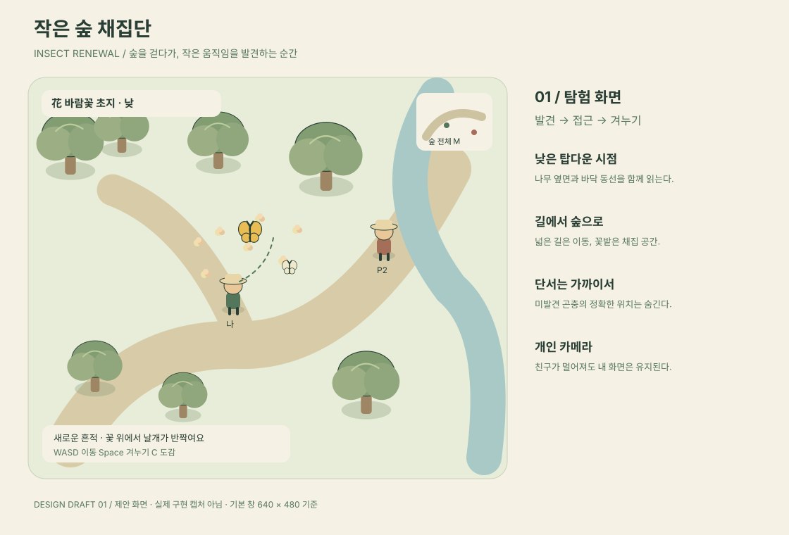
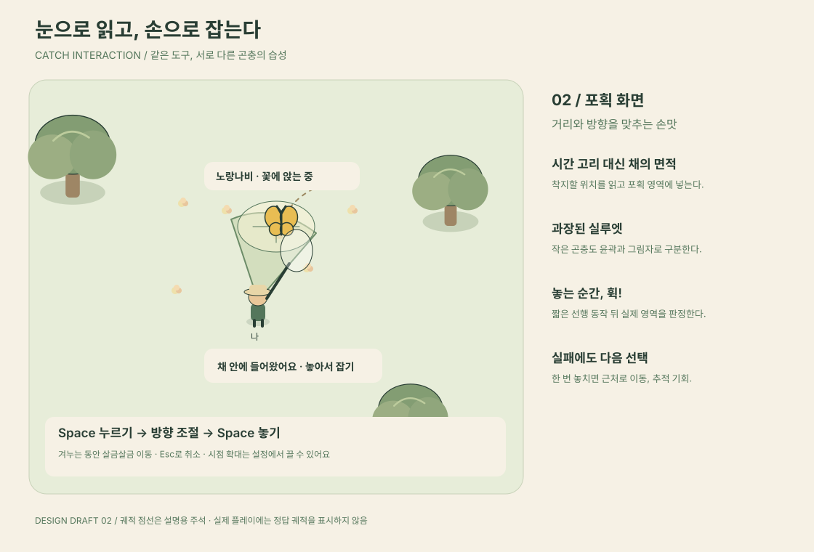
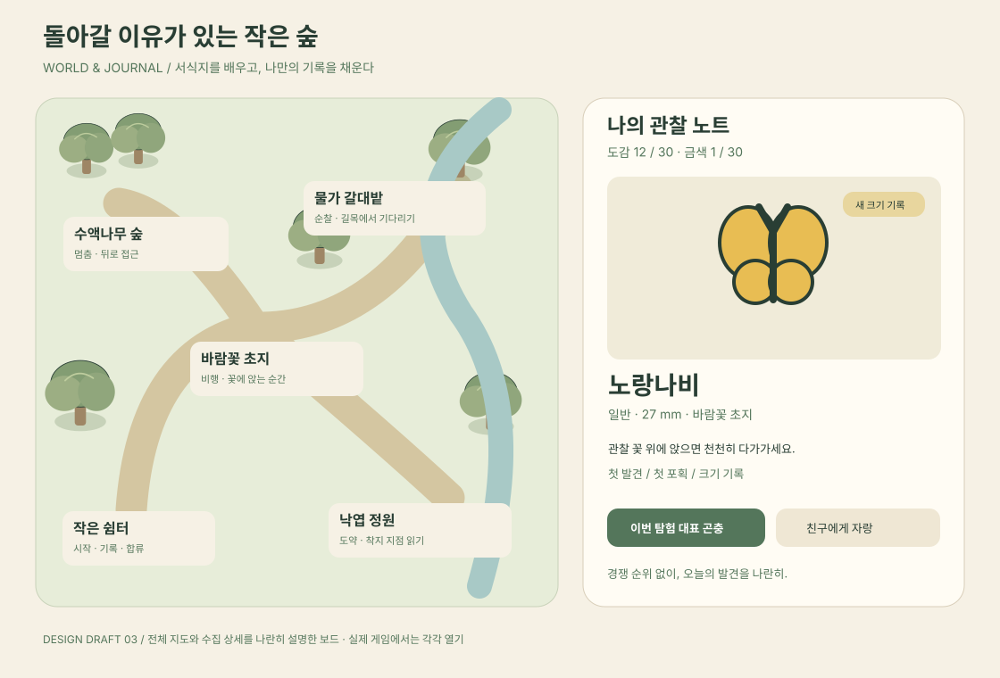

# 곤충채집 개편 기획서 — 작은 숲 채집단

작성일: 2026-10-30 · 대상: `feat/insect` · 상태: 검토용 기획 초안

> **작은 숲에서 곤충의 흔적을 발견하고, 습성을 읽어 가까이 다가간 뒤, 직접 잠자리채를 겨누어 잡는 1~4인 채집 산책 게임.**

기존의 곤충 수집, 실제 곤충 30종, 희귀도, 금색 변종, 영구 보관, 친구와 자랑하기를 유지한다. 플레이 공간과 포획 조작은 새로 설계한다. 아래 수치는 구현 확정값이 아닌 첫 프로토타입의 시작값이며, 재미와 가독성 검증 후 조정한다. 이 문서와 그림은 제안이며 실제 게임은 변경하지 않았다.

## 구현 조정 — 2026-11-02

플레이 화면이 게임보다 앞에 나서 보이지 않도록 시각 요소를 다시 줄였다. 바닥색 면과 상시 HUD를 걷어내고 배경을 투명하게 유지한다. 필드 속 곤충은 종과 희귀도를 읽을 수 없는 같은 크기의 작은 검은 점으로 표현한다. Space 입력 한 번에 캐릭터 앞 원형 범위로 잠자리채를 짧게 내려찍으며, 범위 안에 걸린 곤충을 즉시 포획한다. 조준/유지/놓기 단계와 자동 대상 선택은 없다. 포획 후에만 해당 곤충을 밝힌다.

## 1. 왜 바꾸는가

현재 코드를 기준으로 한 구조 분석이다. 사용자 플레이 테스트로 검증된 결론은 아니다.

| 현재 구조 | 재미를 제한할 수 있는 지점 | 개편 방향 |
|---|---|---|
| 320×280 기준 고정 화면, 좌우 이동 | 이동 경로와 발견 위치에 대한 선택이 적다 | 개인 추적 카메라와 작은 2D 숲 |
| 사거리 안에서 주기적으로 줄어드는 고리에 맞춰 Space | 종마다 외형은 다르지만 마지막 포획 판단은 비슷하다 | 곤충의 동작과 채의 위치를 읽는 공간 판정 |
| 1인 3마리, 4인 최대 6마리, 재등장 5~12초 | 잡고 나면 같은 장소에서 기다리기 쉽다 | 서식지 순환과 가까운 다음 단서 |
| 호스트가 먼저 받은 성공 명령의 곤충을 지급 | 희귀 곤충을 발견해도 친구에게 빼앗겼다고 느낄 수 있다 | 같은 개체를 각자 한 번 포획할 수 있는 협력 규칙 |
| 도감·크기·금색 기록 | 중복 포획의 의미가 약해질 수 있다 | 습성 발견, 탐험 수첩, 대표 곤충 선택 |

변경의 성공 기준은 콘텐츠 양이 아니라 **다음 곤충을 발견했을 때 다른 행동을 선택하게 되는가**다.

## 2. 지켜야 할 경험

- 3분만 들어와도 한 번의 발견과 포획을 경험한다. 10~15분이면 숲 한 바퀴와 작은 목표 하나를 마친다.
- 곤충은 수집 아이콘이 아니라 움직임을 관찰하는 대상이다. 실패 원인을 눈으로 이해할 수 있어야 한다.
- 낮은 긴장 속에 “저거 처음 보는 곤충인데?”라는 순간을 만든다. 체력·사망·장비 내구도·입장 비용은 도입하지 않는다.
- 친구와 함께하면 발견과 자랑이 늘어난다. 경쟁 순위나 선착순 보상으로 채집을 방해하지 않는다.
- 기존의 종이와 연필 같은 부드러운 그림체, 작은 탐험가와 잠자리채를 이어간다.

## 3. 제안하는 핵심 플레이

**산책 → 단서 발견 → 움직임 관찰 → 접근 경로 선택 → 겨누고 포획 → 짧은 보상 → 다음 발견**

| 구간 | 플레이어의 선택 | 느껴야 하는 감정 |
|---|---|---|
| 발견 | 흔들리는 풀을 살펴볼까, 수액나무로 갈까? | 호기심 |
| 관찰 | 날아다니는 나비를 쫓을까, 꽃에 앉기를 기다릴까? | 이해와 기대 |
| 접근 | 빠르게 돌아갈까, 천천히 가까워질까? | 가벼운 긴장 |
| 포획 | 지금 채를 놓을까, 반걸음 더 갈까? | 직접 잡았다는 손맛 |
| 실패 | 이동한 방향을 따라갈까, 다른 곤충을 찾을까? | 재도전 가능성 |
| 기록 | 새 종, 큰 개체, 금색 중 무엇을 자랑할까? | 소유감과 공유 |

### 첫 3분의 예시

1. 쉼터에서 시작하면 화면 안 꽃에 노랑나비가 앉는다. 첫 안내는 “가까이 가서 Space를 눌러 보세요”.
2. 채 범위가 보인다. Space를 누르면 앞쪽에 잠자리채를 내려찍어 포획한다. 최초 연습 개체는 도망가지 않으며, 성공 후 일반 규칙으로 전환한다.
3. 이름과 크기가 1초 정도 나타나고 바로 움직인다. 오른쪽 풀에서 흔들림이 보인다.
4. 메뚜기가 한 번 뛰는 것을 보고 착지 쪽으로 돌아간다. 첫 시도를 놓쳐도 근처로 다시 뛰어 추적한다.
5. 도감에 두 종이 등록된다. “이번 산책에서 서로 다른 서식지의 곤충 3종 만나기”가 다음 방향을 제안한다.
6. 친구가 수액나무에 핑을 찍으면 함께 이동한다. 참여를 강제하거나 타이머로 재촉하지 않는다.

## 4. 카메라와 맵

### 카메라: 낮게 내려다보는 2D 시점

수직 탑다운보다 나무 줄기, 모자, 잠자리채 옆면을 볼 수 있는 약 55도 인상의 2D 표현을 사용한다. 실제 3D나 회전 카메라는 필요하지 않다. 이동은 바닥 평면의 8방향이며, 오브젝트는 발 위치 기준으로 앞뒤를 그린다.

- 기본 창은 640×480을 제안한다. 게임 진입 시 적용하고, 종료 시 이전 창 크기로 복원한다.
- 480×360에서는 안내를 축약한다. 기존 320×280은 접어 둔 상태 화면으로 사용하고 “채집 계속하기”로 펼친다. 작은 상태에서는 이동·포획 입력을 멈추며 개인 경계도도 진행하지 않는다.
- 카메라는 내 캐릭터를 따라가며 진행 방향을 조금 더 보여준다. 맵 가장자리에서는 경계에 고정한다.
- 겨누면 최대 1.12배로 0.2초 동안 확대한다. 화면 흔들림은 기본적으로 사용하지 않으며 확대도 설정에서 끌 수 있다.
- 다른 플레이어와 멀어져도 축소하지 않는다. 화면 밖 친구는 가장자리 방향 표시와 핑으로 찾는다.
- 나무 뒤에 가려지는 곤충과 플레이어 주변의 수관만 반투명 처리한다.

### 맵: 넓이보다 다른 장소를 다시 찾는 이유

첫 버전은 **고정 지형 한 장, 약 1,920×1,440 월드 단위**로 시작한다. 기본 화면에서 보이는 월드 영역은 약 640×480으로, 전체 면적은 약 9화면이다. 일반 이동속도 120단위/초 기준으로 끝에서 끝까지 직선 이동은 약 16초, 지형을 따라 걸으면 25~40초가 되도록 배치한다. 채집과 관찰을 포함한 한 바퀴는 5~8분을 목표로 한다.

| 장소 | 시각적 특징 | 주요 곤충/습성 | 플레이 |
|---|---|---|---|
| 바람꽃 초지 | 노란 꽃 군락, 넓은 시야 | 나비, 꽃에 착지하는 비행 | 착지 대기 또는 가까운 비행 경로 포착 |
| 수액나무 숲 | 큰 줄기, 수액 자국, 좁은 샛길 | 사슴벌레·풍뎅이·매미 | 줄기를 돌아 조용히 접근 |
| 물가 갈대밭 | 물 가장자리, 낮은 풀, 긴 길 | 잠자리의 순찰과 정지 비행 | 길목 선점과 멈추는 순간 포착 |
| 낙엽 정원 | 낙엽, 돌, 흔들리는 풀 | 메뚜기·귀뚜라미·사마귀 | 도약 후 착지 추적 또는 은신 관찰 |
| 작은 쉼터 | 표지판, 관찰 노트, 벤치 | 시작/합류 지점 | 기록 확인과 친구에게 자랑 |

기존 `air/tree/ground`는 유지 가능한 생태 분류이고, 새 서식지는 맵의 장소 분류다. 두 개념을 구분한다. 예를 들어 물가에도 공중 곤충과 지상 곤충이 존재한다. 각 종에 서식지와 행동 유형을 추가한다.

외곽 순환길과 중앙 지름길을 연결해 막다른 길에서 되돌아오는 시간을 줄인다. MVP에서는 물에 들어가기, 점프, 수영, 지형 생성은 넣지 않는다.

### 발견 밀도

전체 맵의 시작 목표는 1인 18마리, 4인 30마리다. 화면 안에 보이는 수는 보통 3~6마리로 제한한다. 모든 개체를 항상 또렷하게 드러내지 않고 일부는 풀 흔들림·줄기 실루엣·울음 표시로 발견한다.

10초 이상 이동했는데 포획 가능한 곤충이나 단서를 못 만나는 구간이 생기면 배치를 수정한다. 플레이어 앞에서 갑자기 생성하지 않고, 화면 밖 서식지에서 보충한다. 가까운 일반종의 기회를 우선 보장하며 희귀 곤충의 생성률을 올리는 방식으로 해결하지 않는다.

## 5. 포획: 누르고 겨누고 놓는다

### 기본 입력

| 입력 | 행동 |
|---|---|
| WASD / 방향키 | 8방향 이동 |
| Space 누르기 | 채를 들고 겨누기 시작, 자동으로 살금살금 이동 |
| Space 유지 + 이동키 | 방향과 접근 위치 조절 |
| Space 놓기 | 그 방향으로 채 휘두르기 |
| Shift | 채를 들지 않고 살금살금 이동 |
| Esc | 겨누기/패널 취소. 포획하지 않음 |
| C / M | 수집 노트 / 전체 지도 |
| E / B | 감정표현 / 최근 곤충 자랑 |
| 마우스 클릭 | 지도가 열렸을 때 핑. 기본 포획에는 마우스 불필요 |

누르고 있기 어려운 사용자를 위해 “Space 한 번으로 겨누고, 다시 눌러 잡기”를 제공한다. 포커스 상실은 항상 취소로 처리한다. 키를 오래 누른다고 채의 위력이 늘어나지는 않는다.

### 공간 판정

겨누면 캐릭터 앞에 부채꼴 방향 안내와 채가 내려갈 타원형 영역을 표시한다. 영역은 실제 포획 판정과 일치해야 한다. 비행 높이는 별도 시각 오프셋으로 처리하며, 바닥 그림자가 포획 위치를 알려준다. 줄기에 붙은 곤충도 같은 규칙으로 겨눌 수 있는 위치에 배치한다.

1. 누르기: 채를 들어 올린다. 일반 이동 120, 겨누기 이동 45단위/초로 시작한다.
2. 조준: 이동 방향을 바라본다. 멈추면 마지막 방향을 유지한다. 근처 곤충을 자동으로 따라가지는 않는다.
3. 놓기: 약 0.12초의 선행 동작 뒤, 0.10초 동안 표시 영역을 쓸어 포획한다. 복귀 동작은 약 0.25초다.
4. 성공: 채의 영역과 곤충의 판정 영역이 겹치면 성공한다. 같은 영역에 여러 개체가 있으면 중심에 가까운 한 마리만 잡는다.
5. 일반 성공은 0.6~0.9초의 짧은 연출과 비차단 알림, 최초 종·금색은 최대 1.5초의 강조 연출을 사용한다. 이동하면 강조 연출을 줄인다.

범위 안에 곤충이 들어오면 채 테두리가 진해지고 문구가 바뀐다. 성공 확정 표시가 아니라 **현재 위치 기준 겹침 안내**다. 휘두르는 동안 곤충이 움직일 수 있다. 타이밍 고리나 무작위 성공 확률은 사용하지 않는다.

### 같은 도구, 네 가지 공략

| 유형 | 읽을 수 있는 예고 | 유효한 선택 | 놓쳤을 때 |
|---|---|---|---|
| 꽃 착지형 | 날갯짓이 느려지고 꽃 주변을 선회 | 꽃 옆에서 기다리거나 비행을 따라 접근 | 다음 꽃으로 이동 |
| 줄기 정착형 | 더듬이가 들리고 몸이 굳으면 경계 | 보이는 방향을 피해 돌아가고 멈춰 기다림 | 줄기 반대편으로 숨었다가 다시 등장 |
| 도약형 | 뒷다리를 접고 몸을 낮춤 | 첫 도약을 보고 착지 지점에 채 준비 | 근거리 재도약, 한 번 더 추적 가능 |
| 순찰형 | 짧은 정지와 반복 왕복 | 뒤쫓기보다 경로의 중간에서 기다림 | 경로 변경 후 순찰 재개 |

30종 모두에 독립 미니게임을 만들지 않는다. 네 유형을 공유하고 속도, 정지 길이, 경계 거리, 이동 폭으로 차이를 준다. 희귀도만으로 반응 시간을 극단적으로 줄이지 않는다. 전설 곤충의 재미는 눈치채기 어려운 서식지와 뚜렷한 습성을 이해하는 데 둔다.

### 실패를 추적으로 연결

경계는 차분함 → 주의 → 도주 준비 → 이탈의 네 단계로 읽힌다. 몸짓과 작은 아이콘을 함께 사용한다. 경계도 수치가 가득 찬 순간 갑자기 사라지는 표현은 피한다.

첫 헛스윙은 가까운 장소로 이동하고 4~6초의 재접근 기회를 준다. 연속으로 몰아붙이면 서식지 밖으로 이탈한다. 일반 이동으로 지나가는 것만으로 화면 밖 곤충까지 도망가지 않는다. 실패 메시지는 “너무 멀어요”, “다음 꽃으로 이동했어요”처럼 다음 행동을 알려준다.

## 6. 수집과 다음 목표

- **도감:** 기존 30종과 일반/금색 기록, 크기, 즐겨찾기, 방생 기록을 보존한다.
- **관찰 기록:** 처음 발견했을 때 서식지 단서를 얻고, 첫 포획으로 습성 한 줄을 연다. 반복 포획으로 원래 알 수 없던 필수 조작을 해금하지 않는다.
- **산책 수첩:** 접속마다 세 가지 선택 목표를 제시한다. 예: 서로 다른 서식지 3종, 도약형 첫 포획, 기존 크기 기록 갱신. 새로고침을 강요하는 날짜 제한이나 연속 출석은 없다.
- **소소한 보상:** 목표를 채우면 노트 스티커나 모자 띠 색을 얻는다. 포획 성능에 차이를 주지 않는다. 보상 꾸미기는 핵심 포획 검증 뒤 추가한다.
- **중복 개체:** 더 큰 크기, 금색, 이번 탐험 대표 곤충 선택에 의미를 둔다. 자동 폐기하지 않고 기존 방생 기능을 제공한다.
- **금색:** 기본 1/50 확률을 우선 유지한다. 가까이에서 색·짧은 빛·선택적 효과음으로 알아볼 수 있다. 발견해도 일반 개체와 동일한 포획 규칙을 적용한다.

첫 버전에서는 시간대 제한, 날씨별 도감 잠금, 장비 강화, 경제 시스템을 넣지 않는다. 네 가지 포획 경험만으로 반복할 이유가 있는지 먼저 검증한다.

## 7. 1~4인 함께 채집

### 공동 발견, 개인 포획

한 화면에 공유된 곤충이 있지만 각 플레이어는 그 개체를 한 번씩 잡을 수 있다. 누군가 성공해도 다른 사람의 곤충은 사라지지 않는다. 잡은 사람에게만 옅은 관찰 실루엣으로 바꾸고 재포획을 막는다. 채집 결과의 종·크기·금색은 같은 개체에 대해 동일하게 지급해 함께 발견한 기억을 공유한다.

개체별 포획 가능 목록은 등장 시점의 방 멤버로 고정한다. 진행 중 합류자는 다음 생성 주기부터 참여하고 2초 내에 새 포획 기회를 배정한다. 전원 포획 또는 개체 수명 종료 후 새 개체로 교체한다. 일반 개체 수명은 90~150초에서 시작하고, 진행 중인 조준에는 짧은 유예를 둔다.

경계와 실패 후 도주 상태는 개인별이다. 다른 사람이 뛰거나 헛스윙해도 내 기회는 사라지지 않는다. 평온할 때는 공통 이동 경로를 사용하고, 실패하면 해당 플레이어의 개체만 잠깐 다른 경로를 따른다. 따라서 실패 후 친구 화면과 곤충 위치가 달라질 수 있다는 구현·표현 비용이 있다. 이 비용은 선착순 스트레스를 없애기 위한 의도적인 선택이다.

### 함께할 이유

핑으로 “수액나무 쪽에 금색!”을 알리고, 친구가 자기 기회를 잡을 때 짧은 성공 말풍선을 본다. 여러 명이 서로 다른 서식지를 살핀 뒤 합류할 수 있다. 채집을 마치면 각자 대표 곤충 한 마리를 나란히 보여주며 전체 순위는 매기지 않는다.

호스트 이탈 시 공통 월드와 개인별 포획/경계 상태를 넘긴다. 전달을 끝내지 못하면 각자 마지막 확인 상태에서 솔로로 이어가되, 동일 포획 ID를 다시 지급하지 않는다. 수집함 저장 실패 시에는 기존처럼 재시도 상태를 보여주며 다음 포획을 막아 누락을 방지한다.

## 8. 게임 디자인 초안

아래 세 장은 직접 작성한 벡터 화면 초안이다. 실제 실행 캡처가 아니며, UI 배치와 장면 분위기를 검토하기 위한 디자인이다. 그림의 일부 단서는 이해를 돕기 위해 확대했다.

### A. 탐험 화면

필드가 화면의 중심이다. 왼쪽 위에는 장소와 분위기, 오른쪽 위에는 작은 지도, 아래에는 현재 행동에 필요한 짧은 안내만 표시한다. 상시 도감 목록이나 큰 목표판은 놓지 않는다. 곤충은 꽃·나뭇잎과 다른 외곽선으로 읽히게 하고 플레이어 주변에만 필요한 단서를 보여준다.

### B. 포획 화면

캐릭터의 자세, 채의 타원, 곤충의 바닥 위치가 하나의 동작으로 읽혀야 한다. 초안의 점선 이동 궤적은 설명용이며 실제 게임에서 미래 위치를 정답처럼 보여주지 않는다. 자동 확대를 꺼도 같은 판정과 안내를 제공한다.

### C. 전체 지도와 관찰 노트

그림은 두 화면을 설명하려고 나란히 배치한 보드다. 실제 게임에서는 M으로 지도, C로 관찰 노트를 각각 연다. 지도에는 장소·친구·핑만 표시하고, 아직 보지 못한 희귀 곤충의 정확한 위치는 표시하지 않는다. 노트는 곤충 그림과 개인 기록을 우선한다.

### 시각·음향 기준

| 요소 | 방향 |
|---|---|
| 종이/패널 | 따뜻한 아이보리 `#F6F1E5`, 손으로 그린 듯한 가벼운 경계 |
| 글자/윤곽 | 짙은 숲색 `#293E34`, 배경보다 확실한 명도 차이 |
| 필드 | 세이지 그린과 연한 흙빛. 채집 대상보다 낮은 대비 |
| 금색 강조 | `#BC893B` + 별 모양 + “금색” 글자. 색만으로 구별하지 않음 |
| 캐릭터 | 큰 모자, 작은 몸, 조준할 때 몸을 낮추는 명확한 자세 |
| 곤충 | 종별 실루엣 유지. 최소 14~20px로 읽히도록 시각 크기 보정 |
| 글자 크기 | 기본 UI 14~16px, 보조 정보 12px 이상. 작은 창에서는 숨기거나 축약 |
| 효과음 | 풀 스침, 채가 가르는 소리, 성공 시 짧은 나무 타악음 |
| 무음 플레이 | 울음은 작은 음표/파문으로도 표시. 소리를 끄면 단서를 잃지 않음 |
| 움직임 줄이기 | 카메라 확대·금색 반짝임 축소. 판정과 입력은 동일 |

## 9. 첫 구현 범위와 검증 순서

| 단계 | 넣는 것 | 다음 단계로 넘어갈 조건 |
|---|---|---|
| 1. 손맛 프로토타입 | 임시 초지, 2D 이동, 개인 카메라, 조준/놓기, 나비·메뚜기·풍뎅이·잠자리 각 1종 | 설명 없이 공간 판정을 이해하고 유형별 공략 차이를 느낀다 |
| 2. 작은 숲 완성 | 고정 맵 4서식지, 30종을 네 행동에 매핑, 발견 밀도, 도감/기존 저장 호환 | 10초 이상의 무의미한 이동·대기가 드물고 반복 포획이 지루하지 않다 |
| 3. 함께 채집 | 개인별 포획 상태, 핑, 개인 카메라, 호스트 이전, 저장 재시도 | 4인에서도 상대 행동 때문에 내 기회가 사라지지 않는다 |
| 4. 장기 동기 | 산책 수첩, 관찰 기록, 스티커, 대표 곤충 보드 | 보상 없이도 재미있는 기본 루프를 강화한다 |

첫 출시 범위는 1~3단계다. 4단계는 후속 범위로 둔다. 단계 1이 재미없으면 맵 확장과 꾸미기 제작을 진행하지 않고 포획 거리·속도·피드백을 다시 조정한다.

### 플레이 테스트 질문과 목표

5~8명의 소규모 사용자 테스트로 시작한다. 아래 값은 현재 성과가 아니라 가설이다.

- 첫 성공까지 중앙값 60초 이내, 90%가 2분 이내. 입력 설명을 읽지 못해서 막힌 사례를 따로 기록한다.
- 튜토리얼 이후 일반종 성공률 60~80%. 첫 시도와 재시도를 분리해 측정한다.
- “나비와 메뚜기를 다르게 잡았다”고 자신의 말로 설명할 수 있는지 확인한다.
- 처음 5분 안에 서로 다른 서식지 2곳을 자발적으로 방문하는지 관찰한다.
- 실패 후 10초 이내 재시도하거나 다른 발견으로 이동하는지 확인한다.
- 10분 플레이 후 “한 마리 더 잡고 싶다”는 이유가 조작·발견인지, 보상만인지 묻는다.
- 4인 테스트에서 기다림, 화면 혼잡, 선착순 스트레스, 개인 개체 상태 혼동을 기록한다.

자동으로 사용자 데이터를 수집하는 기능은 이 기획에 포함하지 않는다. 초기 검증은 동의한 테스트 참가자의 관찰과 로컬 로그로 진행한다.

## 10. 구현 시 유지할 것과 바꿀 것

기술 방향은 후속 구현을 위한 범위 설명이며 게임 내부 안내에 노출하지 않는다.

| 영역 | 계획 |
|---|---|
| `src/shared/insect.ts` | 종 ID와 기존 포획 데이터 보존. 서식지·행동 유형 추가. 관찰/꾸미기 데이터는 별도 버전으로 관리 |
| `src/main/insect-store.ts` | 저장·백업·가져오기·방생 기능 재사용. 구버전 저장은 백업 후 변환하며 기존 크기/금색/ID를 재추첨하지 않음 |
| `engine.ts` | 정규화된 1D 위치에서 2D 월드 좌표로 변경. 곤충 공통 경로, 개인 경계, 포획 자격을 분리 |
| `input.ts` | 2축 입력, Space 누름/유지/해제, 취소, 토글 조준 추가 |
| `draw.ts` / `art.ts` | 종별 곤충 그림 재사용 가능성 확인. 개인 카메라, 깊이 정렬, 발밑 그림자, 가림 처리 추가 |
| `module.ts` | 조준 상태와 포획 명령 동기화. 게스트 이동 예측과 보정 유지, 호스트가 최종 포획 판정 |
| 창 관리 | 곤충 게임의 권장 크기·접기·복원을 관리하고 다른 게임의 기본 창 정책과 분리 |
| 네트워크 | 증가한 개체 수에 맞춰 패킷 크기 측정. 필요 시 변경분/관심 영역만 전송. 모든 개체를 매 프레임 JSON으로 보내는 방식은 재검토 |

포획 판정은 호스트의 최근 위치/방향/개체 상태 이력을 사용해 최대 약 150ms의 지연 보정을 검토한다. 클라이언트의 “성공했다” 주장만으로 지급하지 않는다. 같은 입력 재전송과 호스트 변경에도 포획 ID 기준으로 중복 저장을 막는다. 구형/신형 프로토콜의 방 참가 호환성도 확인하고, 호환이 불가능하면 다른 버전의 방에 참가하지 못하도록 명확히 안내한다.

필수 검증은 공간 포획 경계, 키 해제/포커스 상실, 장애물 통과, 가림 처리, 4인 지연·손실, 호스트 이탈, 중복 명령, 저장 실패 재시도, 기존 수집함 가져오기다. 성능 목표는 기준 장비를 정한 뒤 기본 창에서 60fps, 렌더링과 시뮬레이션 합산 p95 16ms 이내로 검증한다.

## 11. 주요 위험과 조정안

| 위험 | 먼저 확인할 것 | 조정 |
|---|---|---|
| 맵이 넓어져 기다림이 이동으로만 바뀐다 | 이동 중 단서 없는 시간 | 면적 축소, 지름길, 화면 밖 일반종 보충 |
| 2D 조준이 작은 창에서 어렵다 | 거리/방향 오판 비율 | 곤충 가독성, 타원 표시, 방향 수/범위 조정 |
| 계속 살금살금만 걷게 된다 | 이동 시간 중 겨누기 비율 | 길의 경계 영향 축소, 서식지 접근 구간만 긴장 부여 |
| 개인별 곤충 상태가 친구와 다르게 보인다 | 핑 대상과 위치 혼동 | 공통 개체 ID/장소 핑, 실패 후에만 개인 경로 분기 |
| 모두 같은 금색을 받으면 특별함이 약해진다 | 함께 발견한 만족과 개인 기록 만족 | 금색은 공동 발견, 크기 기록과 관찰 기록으로 개인성 보완 |
| 30종 제작이 손맛 검증을 늦춘다 | 4종만으로 반복 재미가 생기는가 | 네 행동 유형을 먼저 완성하고 기존 아트 재사용 |
| 큰 필드가 다른 작업 화면을 가린다 | 640×480 창의 부담 | 원클릭 접기, 이전 크기 복원, 불투명 지면은 게임 영역에 한정 |

## 12. 권장 결정

**낮은 탑다운 시점 + 작은 연결형 숲 + Space를 누르고 놓는 공간 포획**을 주안으로 삼는다. 다음 작업은 네 종류의 곤충만 있는 포획 프로토타입이다. 첫 검토에서는 ① 커진 창을 감수할 만큼 탐험이 즐거운지, ② 직접 겨누는 방식이 기존 고리보다 손맛이 좋은지, ③ 같은 개체를 함께 잡는 협력 방식이 자연스러운지를 우선 판단한다.
